<!-- ========================================================= -->
<!--                 CHINMAYEE MHATRE                          -->
<!--                  GITHUB PROFILE                           -->
<!-- ========================================================= -->

<!-- ================= RESPONSIVE BANNER ================= -->

<picture>
  <source media="(prefers-color-scheme: dark)" srcset="header-dark.svg">
  <source media="(prefers-color-scheme: light)" srcset="header-light.svg">
  
</picture>

 

# Hey there, I'm Chinmayee Mhatre 👋

 

  

---

<!-- ================= ABOUT ME ================= -->

<h2 align="center">🌸 About Me</h2>

<table align="center">
<tr>
<td width="65%" valign="middle">

### Hello, I'm Chinmayee! 💗

I'm a Computer Science and Engineering student passionate about technology, creativity, and innovation.

- 🎓 Computer Science Engineering Student
- 🔐 Exploring Cybersecurity & Ethical Hacking
- 💻 Interested in Full-Stack Development
- 🤖 Exploring Artificial Intelligence & Machine Learning
- ⛓️ Learning Blockchain Technology
- 🚀 Building projects that solve real-world problems
- 🌱 Always learning and improving my skills
- 🤝 Open to collaborations and opportunities

**My Goal:** To turn ideas into impactful technology and keep growing every day!

</td>

<td width="35%" align="center" valign="middle">

  

</td>
</tr>
</table>

---

<!-- ================= TECH STACK ================= -->

<h2 align="center">💻 Tech Stack & Tools</h2>

### 👩‍💻 Programming Languages

  

### 🌐 Web & App Development

  

### 🗄️ Database & Backend

  

### 🔐 Cybersecurity & Development Tools

  

### ⛓️ Blockchain

---

<!-- ================= GITHUB STATS ================= -->

<h2 align="center">📊 GitHub Statistics</h2>

  

---

<!-- ================= CONTRIBUTION GRAPH ================= -->

<h2 align="center">🌷 Contribution Activity</h2>

  

---

<!-- ================= CONTRIBUTION SNAKE ================= -->

<h2 align="center">🐍 Watch My Contributions Get Eaten!</h2>

<!--
=========================================================
GITHUB CONTRIBUTION SNAKE ACTION
=========================================================

Create this file:

.github/workflows/snake.yml

Paste the following:

name: Generate Contribution Snake

on:
  schedule:
    - cron: "0 0 * * *"
  workflow_dispatch:
  push:
    branches:
      - main

jobs:
  generate:
    permissions:
      contents: write

    runs-on: ubuntu-latest

    steps:
      - name: Generate Snake
        uses: Platane/snk/svg-only@v3
        with:
          github_user_name: chinmayeemhatre
          outputs: |
            dist/github-contribution-grid-snake.svg

      - name: Deploy Snake
        uses: crazy-max/ghaction-github-pages@v4
        with:
          target_branch: output
          build_dir: dist
        env:
          GITHUB_TOKEN: ${{ secrets.GITHUB_TOKEN }}

IMPORTANT:

1. Open Repository Settings.
2. Select Actions > General.
3. Find Workflow permissions.
4. Enable Read and write permissions.
5. Save changes.
6. Open Actions.
7. Run Generate Contribution Snake manually.

=========================================================
-->

---

<!-- ================= CONNECT ================= -->

<h2 align="center">💌 Let's Connect!</h2>

Let's connect, share ideas, and build something amazing together!

---

<!-- ================= QUOTE ================= -->

<h2>✨ A Little Reminder</h2>

<i>"Dream it. Code it. Build it. Become it."</i> 💗

  

**Keep Learning • Keep Building • Keep Growing**

---

<!-- ================= FOOTER ================= -->

### Thanks for visiting my profile! 🌸

Made with 💗 by Chinmayee Mhatre

© 2026 Chinmayee Mhatre

